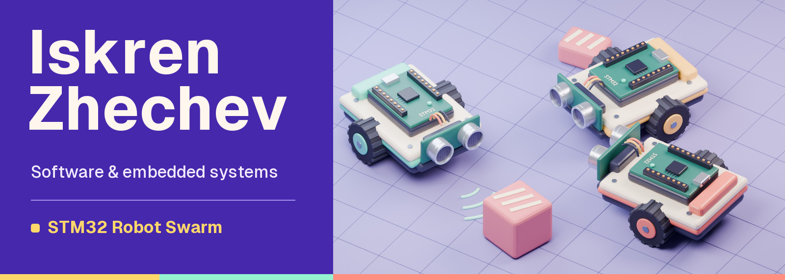
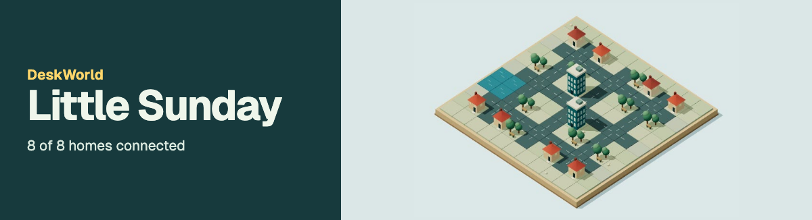
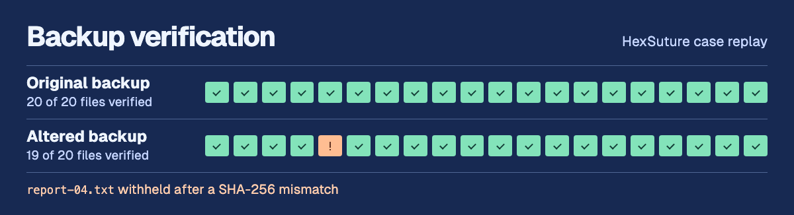

# 

I build software and embedded systems. I study ICT at Fontys and am currently on exchange at UAS Technikum Wien in Vienna. My favourite projects let you see code doing something in the physical world, like a robot sorting objects or a webcam turning pieces of paper into buildings.

[Projects you can try](#projects-you-can-try) · [More projects](#more-projects) · [LinkedIn](https://www.linkedin.com/in/iskren-zhechev-70bb66199/)

## Projects you can try

### DeskWorld

Repair roads and get the neighbours home before a storm hits. Build with a mouse or use coloured paper and a webcam. The city and camera processing run in your browser.

[DeskWorld source code](https://github.com/izhechev/deskworld)

### HexSuture

HexSuture records Microsoft Defender findings and checks which files can be restored from a backup. The demo replays a synthetic Windows case from scan to recovery.

[HexSuture source code](https://github.com/izhechev/HexSuture)

## More projects

### Robotics and embedded systems

- **[AdaptSort Robot Arm](https://github.com/izhechev/adaptsort-robot-arm)** uses computer vision to sort objects with a robot arm and log them to a web dashboard. Built with an Erasmus+ team.
- **[STM32 Robot Swarm](https://github.com/izhechev/stm32-robot-swarm)** uses ultrasonic sensors to avoid obstacles and reports to a Node-RED dashboard over MQTT.
- **[Smart Medicine Plate](https://github.com/izhechev/smart-medicine-plate)** sends readings from an ESP32 sensor plate. Built with Ericsson and Fontys.
- **[3D Printer Component Tester](https://github.com/izhechev/3d-printer-component-tester)** uses a C# desktop app and C++ firmware to test printer movement, heating and enclosure controls separately.

### Apps and integrations

- **[LoadLight](https://github.com/izhechev/loadlight)** turns plain-language notes into tasks and helps you see what you’ve already taken on. [Open the app](https://loadlight.vercel.app/).
- **[Canvas MCP for Microsoft Teams](https://github.com/izhechev/canvas-mcp-teams)** brings Canvas grades, announcements and assignment feedback into Teams. Built with a team.

Other projects

- [Greenhouse Agro Roofing Site](https://github.com/izhechev/greenhouse-agro-site) · [Live site](https://greenhouse-agro-site.vercel.app/)
- [CryptoBot Paper Trading](https://github.com/izhechev/cryptobot-paper-trading) · Market scanning and simulated trade tracking
- [CryptoAdvisor LLM](https://github.com/izhechev/crypto-advisor-llm) · Market research and Telegram alerts

## Tools I use

**Languages** · C, C++, C#, Python, TypeScript

**Tools and platforms** · ROS 2, STM32, ESP32, MQTT, Docker
